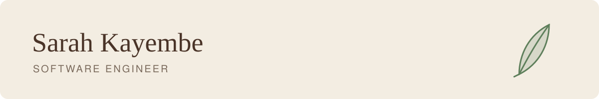

<picture>
  <source media="(prefers-color-scheme: dark)" srcset="assets/header-dark.svg">
  
</picture>

### Hi there!

I'm [Sarah](https://sarah-kayembe.github.io), a software engineer who builds full-stack apps and AI tools for real people.

I currently work as a software engineer at [Chanzo](https://chanzoworks.com), building custom software and web apps. Before that, I was a software developer at the University of Southern Maine, where I also earned my M.S. in Computer Science. My thesis looked at how large language models can help answer legal questions.

I'm drawn to software that helps with everyday life, like a health screening anyone can take on their phone, a weather app that tells you what to eat, or a study tool my friends keep asking me to bring back.

Outside of work, I dance and lead a youth dance group, sing, read a lot, and volunteer with environmental and community causes.

Let's connect! [LinkedIn](https://linkedin.com/in/sarah-kayembe) · [Email](mailto:sarahmbumbakayembe@gmail.com) · [Portfolio](https://sarah-kayembe.github.io)

#### 🌱 Live projects

- [**ReBona**](https://rebona.vercel.app) · A free, anonymous screening that helps people check their risk for diabetes and high blood pressure. ([code](https://github.com/Sarah-Kayembe/rebona))
- [**Guess the Flavor**](https://sarah-kayembe.github.io/guess-the-flavor/) · A party game where friends guess a flavor before it's revealed. ([code](https://github.com/Sarah-Kayembe/guess-the-flavor))

#### 🪵 More of my work

- [**BiteCast**](https://github.com/Sarah-Kayembe/bitecast) · A weather app that suggests what to eat and where to find it nearby, with a Gemini agent.
- [**Legal entailment with LLMs**](https://github.com/Sarah-Kayembe/legal-entailment-coliee2026) · My master's thesis, finding which laws and past cases answer a legal question.
- [**Family Planning Register**](https://github.com/Sarah-Kayembe/FamilyPlanning-GH-2025) · A desktop app that replaces paper registers for clinic nurses. I led a team of five.
- [**Study Buddy Hub**](https://github.com/Sarah-Kayembe/study-buddy-hub) · A study app built by a team of four. I built the data pipeline, study schema and timer.
