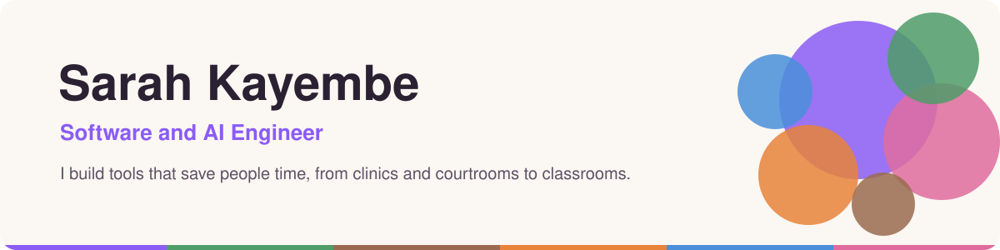
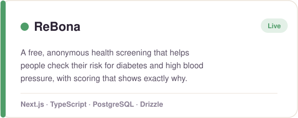
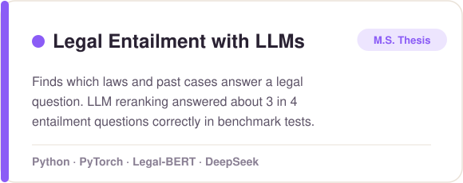
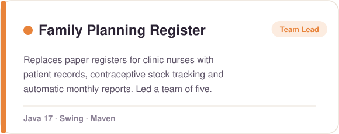
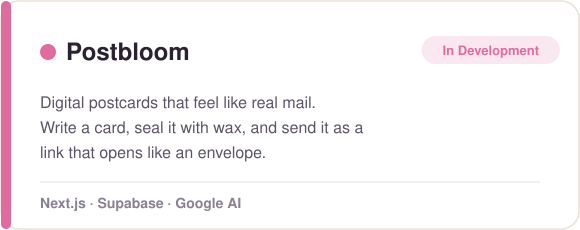
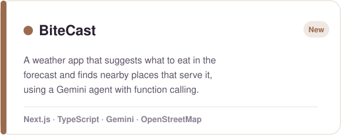
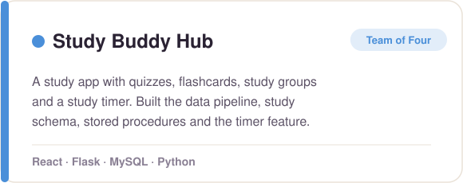

<picture>
  <source media="(prefers-color-scheme: dark)" srcset="assets/banner-dark.svg">
  
</picture>

 

Hi, I'm Sarah 👋

I'm a software engineer who builds full-stack apps and AI tools for real people, like health screenings that clinics can use, research tools for legal questions, and apps that make everyday work less tedious. I have an M.S. in Computer Science, and my research is in NLP and large language models.

I'm currently a Software Engineer at Chanzo, and I'm open to full-time software and AI engineering roles.

### 🛠 What I work with

 

 

### ✨ Featured work

<table>
<tr>
<td width="50%">
<a href="https://rebona.vercel.app">
<picture>
  <source media="(prefers-color-scheme: dark)" srcset="assets/rebona-dark.svg">
  
</picture>
</a>
</td>
<td width="50%">
<a href="https://github.com/Sarah-Kayembe/legal-entailment-coliee2026">
<picture>
  <source media="(prefers-color-scheme: dark)" srcset="assets/legal-entailment-dark.svg">
  
</picture>
</a>
</td>
</tr>
<tr>
<td width="50%">
<a href="https://github.com/Sarah-Kayembe/FamilyPlanning-GH-2025">
<picture>
  <source media="(prefers-color-scheme: dark)" srcset="assets/family-planning-dark.svg">
  
</picture>
</a>
</td>
<td width="50%">
<picture>
  <source media="(prefers-color-scheme: dark)" srcset="assets/postbloom-dark.svg">
  
</picture>
</td>
</tr>
<tr>
<td width="50%">
<a href="https://github.com/Sarah-Kayembe/bitecast">
<picture>
  <source media="(prefers-color-scheme: dark)" srcset="assets/bitecast-dark.svg">
  
</picture>
</a>
</td>
<td width="50%">
<a href="https://github.com/Sarah-Kayembe/study-buddy-hub">
<picture>
  <source media="(prefers-color-scheme: dark)" srcset="assets/study-buddy-hub-dark.svg">
  
</picture>
</a>
</td>
</tr>
</table>

### 📄 Research

- **Segmentation Granularity and LLM Reranking in Multi-Stage Legal Entailment** (M.S. thesis, COLIEE 2026)
- Co-author, employee turnover prediction paper, IEEE/ACIS SERA 2025

### 📫 Let's connect

